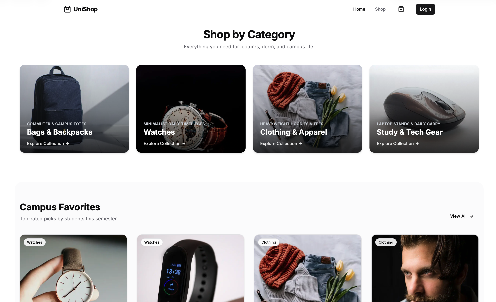

# UniShop — Student Lifestyle & E-Commerce


<p align="center">
  
</p>

<p align="center">
  <a href="https://unishop-client.vercel.app"></a>
  <a href="https://github.com/sojibulislamrana/unishop-c"></a>
  <a href="https://github.com/sojibulislamrana/unishop-server"></a>
</p>

UniShop is a modern, minimalist e-commerce platform tailored specifically for university students. Designed with a clean Scandinavian aesthetic, UniShop curates everyday essentials across bags, timepieces, streetwear apparel, and campus study gear with direct-to-dorm delivery and instant online checkout.

---
## Quick Links

* **Live Website**: [https://unishop-client.vercel.app](https://unishop-client.vercel.app)
* **Frontend Repository**: [https://github.com/sojibulislamrana/unishop-c](https://github.com/sojibulislamrana/unishop-c)
* **Backend Repository**: [https://github.com/sojibulislamrana/unishop-server](https://github.com/sojibulislamrana/unishop-server)
---

## ✨ Features

* **Curated Student Catalog**: Tailored categories including *Bags & Backpacks*, *Watches*, *Clothing & Apparel*, and *Study & Tech Gear*.
* **Persistent Shopping Bag & Slide-over Drawer**: Full Cart Context with real-time badge count, item quantity adjustments, subtotal tracking, and `localStorage` persistence.
* **Campus Checkout & Online Card Payment**: Integrated student checkout capturing student dorm/hall room details, phone/WhatsApp, and secure 256-bit encrypted card payments.
* **Student Promo Engine**: Working promo code support (`CAMPUS10` for 10% off, `WELCOME20` for 20% off) applied directly at checkout.
* **Store & Order Dashboard**: Real-time sales metrics, revenue analytics, and an Order Management view to inspect dorm deliveries and update order status (`Pending` → `Delivered`).
* **Image Resilience**: Next.js optimized images with automated fallback handlers to guarantee zero broken images across the store.

---

## 🛠 Tech Stack

* **Framework**: [Next.js 16](https://nextjs.org/) (App Router, Turbopack)
* **Library**: [React 19](https://react.dev/)
* **Language**: [TypeScript](https://www.typescriptlang.org/)
* **Styling**: [Tailwind CSS 4](https://tailwindcss.com/)
* **Icons**: [Lucide React](https://lucide.dev/)
* **Authentication**: [NextAuth.js](https://next-auth.js.org/)
* **Deployment**: [Vercel](https://vercel.com/)

---

## 📂 Project Structure

```
unishop-c/
├── public/                 # Static assets & cover image
│   └── cover.png
├── src/
│   ├── app/                # Next.js App Router pages
│   │   ├── admin/add/      # Add new catalog items
│   │   ├── dashboard/      # Admin analytics & campus orders
│   │   ├── items/          # Product collections & detail views
│   │   ├── login/          # Student & admin sign-in
│   │   ├── layout.tsx      # Root layout (Cart, Modals, Navbar)
│   │   └── page.tsx        # Storefront home page
│   ├── components/         # Reusable React components
│   │   ├── ui/             # Core UI primitives (Button, Input, Toast)
│   │   ├── CartDrawer.tsx  # Slide-over shopping bag
│   │   ├── CheckoutModal.tsx # Student checkout & online payment
│   │   ├── Navbar.tsx      # Responsive header with cart counter
│   │   └── ProductCard.tsx # Resilient product card
│   ├── context/            # React Context providers (CartContext)
│   └── lib/                # Configuration and utilities
└── next.config.ts          # Image optimization & remote domain rules
```

---

## 👨‍💻 Author

* **Sojibul Islam Rana** — [GitHub Profile](https://github.com/sojibulislamrana)

---

## 📄 License

This project is licensed under the [ISC License](LICENSE).
